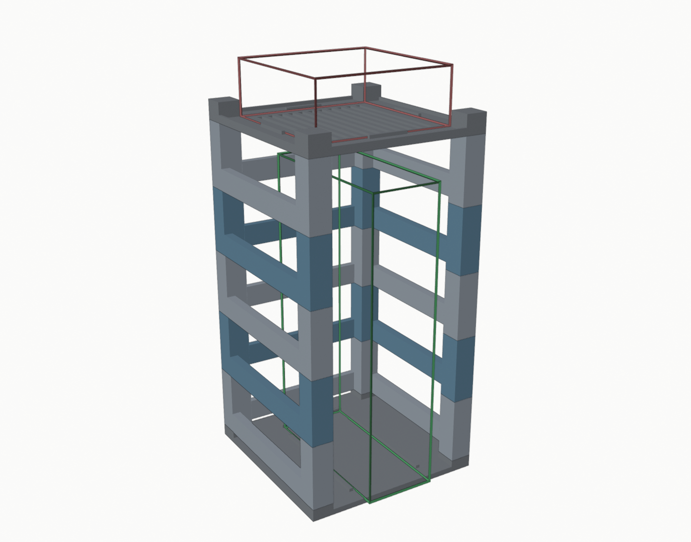
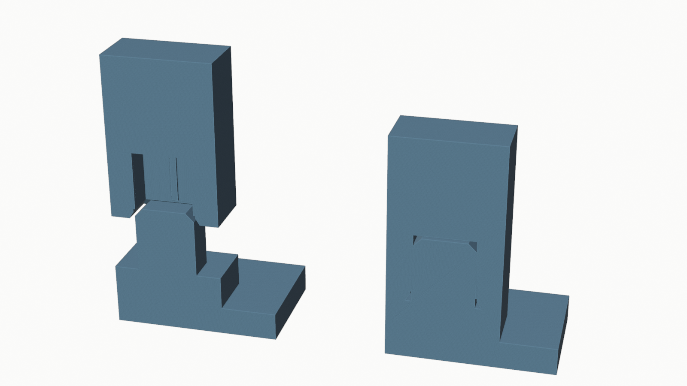
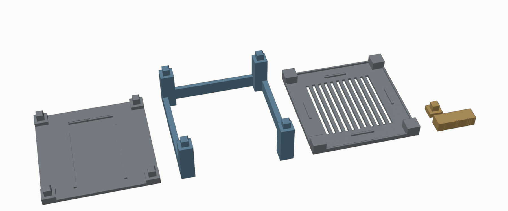
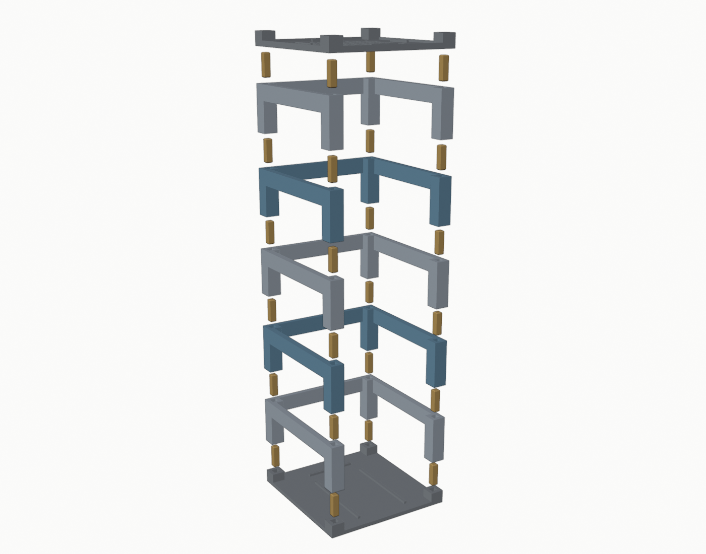

# layerdock

A modular, 3D-printable device stand built with stackable layers, an open frame, and interchangeable top and base plates.

模組化 3D 列印設備架：**Base + Layer × N + Top**，每個接面都是零件自帶的**方榫（公）+ 方孔（母）**，不需要插銷、螺絲或膠。
第一個用途：Mac mini（M4）放頂部，Xbox Series S 直立放在架子裡，**從前方直接抽出**，抽走後 Mac mini 依然由架子承重。

目前版本 **v0.1.1**：一體式接頭、A1 mini 可列印性驗證。

**列印狀態（2026-10-20）**：試件、Base、第 1 個 Layer 已用 PLA 印出並壓合成功；Top 與其餘 Layer 用 `print/` 裡的專案檔直接印。



綠色線框是 Xbox Series S（直立），紅色線框是 Mac mini。

## 設計重點

| 項目 | 決定 | 原因 |
| --- | --- | --- |
| 印表機 | Bambu Lab A1 mini，180 × 180 mm | 每個零件外形 **166 × 172 mm**，四邊留 4–7 mm，可加 brim。全部單件、免支撐，**照檔案方向直接印** |
| Layer | 四角柱 20 × 20 + 左右側樑 + 後樑（都在底部）、**前方全開、中間完全鏤空** | Xbox 空間內沒有任何橫板；每層一模一樣，印幾個疊幾層 |
| 接頭 | 柱頂 **11 × 11 × 12 mm 方榫**，下一件底部對應方孔，孔內四條**壓合肋** | 零件直接互插、可重複拆裝、受力走柱子端面，見下方 |
| Xbox 方向 | 直立，**電源鍵那面（63.5 mm 窄面）朝前**，圓形風扇面朝側邊 | 180 mm 平台塞不下「151 mm 面朝前 + 手指空隙 + 柱子」，見下方 |
| 層高 | 60 mm × 5 層；Xbox 上方淨高 306 mm | Xbox 275 + 餘裕；要更高就多疊一層 |
| 材料 | PLA（Jones 家裡的料）；PETG 亦可 | 室內靜置、1 kg 內，PLA 足夠；切片報告以 Bambu PLA Basic 計算 |

### 為什麼 Xbox 要轉 90°

Xbox Series S 直立時是 63.5（寬）× 151（深）× 275（高）mm。151 mm 的風扇面朝前的話，要在 180 mm 內同時放下 Xbox、兩側伸手的空隙和兩根柱子，數學上不夠。
轉 90° 讓 63.5 mm 的窄面朝前（微軟官方直立擺法，電源鍵朝前）：柱子之間 126 mm 開口，Xbox 兩側各留 **31 mm** 給手指；接線面朝後，後方有 **23 mm** 的插頭空間；Xbox 前緣比架子突出 8 mm，好抓。

## 一體式接頭（v0.1.1）



剖面圖：左邊是 Base 的方榫和 Layer 柱子底部的方孔分開的狀態，右邊是壓到底的狀態。孔壁上的細直條就是壓合肋。

### 比較過的方案

| 方案 | 做法 | 結論 |
| --- | --- | --- |
| A. 直方榫 + 方孔 + 壓合肋（**採用**） | 柱頂長出 11 × 11 × 12 mm 方榫，頂端 1.5 mm 導角；下一件底部 11.5 × 11.5 × 12.5 mm 方孔，孔口 0.8 mm 導角，孔內四條 1.2 × 0.35 mm 直肋 | 全部垂直列印、零懸空；重量由 20 × 20 mm 柱子端面對端面傳遞，方榫只負責定位；壓合肋被方榫擠壓變形後吃掉列印誤差，壓到底就沒有間隙晃動；肋壞了只影響手感不影響承重 |
| B. 錐形榫 + 錐形孔（莫氏錐度） | 榫和孔都做 2–3° 錐度，自動對心 | 可印，但兩難：留間隙就等於方案 A 少了肋；做干涉則榫會在到底前卡住，柱子端面碰不到，高度隨公差變、受力走錐面 |
| C. 卡扣（懸臂鉤扣進孔壁窗口） | 榫側面做彈臂，扣進孔壁的方窗 | 有正向防脫，但彈臂垂直列印時彎折應力正好跨層線，PETG 反覆拆裝會從根部斷；窗口和鉤子下緣需要支撐或犧牲橋。對 1 kg 的靜置架子，風險大於好處 |
| D. 樂高式多顆圓柱 | 每柱頂 4 顆 Ø4.8 圓柱 | 小特徵靠摩擦，磨幾次就鬆；承重面被圓柱切碎 |

### 老實說明：沒有正向鎖定

方案 A 只靠摩擦（壓合肋）防止分離，**沒有卡扣**。整座架子是靠重力和摩擦疊在一起，往上拔可以拆開。這對放地上、頂部放 Mac mini 的用途是夠的，也是能多次拆裝的前提。如果實測後覺得摩擦不夠，可以把 `socket_fit` 調小 0.05，或把 `rib_h` 從 0.35 加到 0.45。若將來要真正鎖死，最可靠的補強是在每根柱子側面加一支 M3 自攻螺絲穿進方榫，這版沒有做。

### 側向晃動與累積公差

- 每層的四根柱子端面壓在下一件的端面上，所以層與層之間**沒有上下方向的間隙**，整層不會翹起來傾斜。
- 剩下的自由度只有水平平移，每個接面最多 2 × `socket_fit` = 0.3 mm（肋壓合後接近 0）。六個接面全部同方向累積也只有 1.8 mm，可忽略。
- 方榫 12 mm 深、11 mm 寬，方形本身防轉。

## 各零件

已切好的 Bambu Studio 專案檔在 [`print/`](print/)（A1 mini、Bambu PLA Basic、0.20 mm Standard、紋理 PEI、socket_fit 0.25），直接開啟按 Print。要印第 N 層就再開一次 `print/layer.3mf`。



| 零件 | 檔案 | 數量 | 說明 |
| --- | --- | --- | --- |
| Base | `stl/base.stl` | 1 | 5 mm 底板 + 四角 6 mm 凸台 + 方榫朝上。板面平的，Xbox 可以自由挪動（導引肋和止擋肋做成參數 `guides` / `rear_stop`，預設關，Jones 要保留擺放彈性） |
| Layer | `stl/layer.stl` | 5 | 四角柱 60 mm，底部方孔、頂部方榫；8 mm 側樑與 6 mm 後樑在底部，前方全開 |
| Top | `stl/top.stl` | 1 | 4 mm 托盤 + 3 mm 圍邊 + 四個 Mac mini 定位擋塊 + 11 條通風槽；四角 20 × 20 凸台朝上，方孔從底面進入 |
| 接頭試件 | `stl/test-coupon.stl` | 1 | 一條三孔的條（孔口在底面，和正式件一樣朝下印），間隙 0.20 / 0.25 / 0.30 mm，側面刻 1 / 2 / 3 道記號對應；旁邊一個 8 mm 短柱 + 方榫。**先印這個** |



## A1 mini 列印驗證

### 已做：Bambu Studio 2.8 CLI 切片乾跑（本機實際切片，未列印）

用 Bambu Studio 內建的 `Bambu Lab A1 mini 0.4 nozzle` + `0.20mm Standard @BBL A1M` + `Bambu PLA Basic` + 紋理 PEI 板，**未改任何參數**。完整表在 [docs/print-report.md](docs/print-report.md)。

| 零件 | 時間 | 材料 | 噴頭實際走過的範圍 | 自動 brim | 支撐 |
| --- | --- | --- | --- | --- | --- |
| Base | 1 h 47 m | 89 g | 165.6 × 171.6 mm | 判定不需要 | 無 |
| Layer（×5） | 1 h 57 m | 70 g | 165.6 × 171.6 mm | 判定不需要 | 無 |
| Top | 2 h 10 m | 79 g | 165.6 × 171.6 mm | 判定不需要 | 無 |
| 試件 | 24 m | 11 g | 59.6 × 49.6 mm | 判定不需要 | 無 |

整套（5 層）約 **13.7 小時、520 g PLA**（PETG 約 16.5 小時、490 g）。切片特徵只有牆、填充、頂底面、方孔天花板的 11 mm 橋接；沒有懸空（overhang）警告、沒有支撐。

### 幾何層面的檢查（`tools/check_stl.py`，每次建置都跑）

- 四個 STL 都是水密、流形、法線向外、原點在平台上、外形 ≤ 180 mm。
- 平台接觸面：Base 與 Top 整片 166 × 172 mm 底面；Layer 是三條橫樑加四根柱底，約 4,500 mm²，柱子不是孤立站著，所以不怕 60 mm 高的柱子被撞倒。
- 列印方向就是建模方向：Base 板朝下、榫朝上；Layer 橫樑朝下、方孔口在平台、榫朝上；Top 板朝下、方孔口在平台、凸台朝上。方孔口在平台那面會有象腳效應，所以孔口有 0.8 mm 導角；孔的天花板是 11 mm 橋接，在 PETG 上沒問題。

### 建議的列印設定（相對於預設）

- 牆數 2 → **4**：方榫和孔壁才會接近實心，摩擦和抗側向更好（時間約 +15%）。
- 填充 15% → 20%，Base 與 Top 可留 15%。
- 象腳補償 0 → 0.15 mm（孔口導角已經處理大部分，這是保險）。
- Brim：自動判定不需要。PETG 在紋理 PEI 上大面積平板偶爾翹角，若擔心可開 3 mm brim，166 × 172 + 6 仍在 180 內。
- 第一層用預設 0.2 mm，紋理 PEI 板不需要膠水。

### 尚未做（需要實體測試）

- **方榫手感**：PLA 下 0.25 mm 間隙剛好（試件）；Base + Layer 實際堆疊 2026-10-20 已測，壓合正常。
- **壓合肋**是否如預期被擠扁而不是把孔撐裂（4.35 mm 孔壁，應該不會）。
- 大平板的翹曲：切片無法預測，看第一片 Base。
- 長期蠕變：PETG 在 1 kg 靜載下不會有問題，但沒有實測。

## 穩定性評估（計算值，未實測）

質量用切片器的預設設定估計（PLA）：Base 89 g、Layer 70 g × 5、Top 79 g，架子共約 520 g。Xbox Series S 1.93 kg、Mac mini M4 0.67 kg。底座半寬 83 × 86 mm。

| 狀態 | 總重 | 重心高度 | 傾倒角 | 在頂部水平推多少力會倒 |
| --- | --- | --- | --- | --- |
| 架子 + Mac mini + Xbox | 3.09 kg | 188 mm | 24° | 約 7.4 N（0.75 kgf） |
| 架子 + Mac mini（Xbox 抽走） | 1.16 kg | 264 mm | 17.5° | 約 2.8 N（0.29 kgf） |
| 對照：Xbox 單獨直立 | 1.93 kg | 138 mm | 13° | 約 2.2 N |

結論：Xbox 在裡面時很穩；Xbox 抽走後的抗傾倒和現在一台直立的 Xbox 差不多，比它還好一點。地毯上建議靠牆或桌腳放，線不要從頂部側向拉。

其他項目：

- **Mac mini 頂部承重**：0.67 kg 分到四根 20 × 20 mm PETG 柱子，應力可忽略；Top 板 4 mm 跨距最長 126 mm，中央擋塊之間有 11 條通風槽，靜載撓度不明顯。
- **Xbox 抽取**：前方全開，兩側各 31 mm 空隙，底板平的，直接往前拉。
- **Xbox 後方接線**：Xbox 背面到後樑 23 mm；後樑只有每層底部 20 mm 高，插頭可以從樑之間的 40 mm 開口穿出，線往下或往側邊彎。
- **Xbox 側面散熱口**：風扇圓面朝側邊，離柱子 31 mm，側面每層有 132 × 40 mm 的開口（67% 開放）。
- **Mac mini 底部進氣**：托盤中央 11 條 5 × 111 mm 通風槽，在 Mac mini 腳座範圍內開口率約 38%。

## 組裝

1. Base 平放，方榫朝上。
2. 第一個 Layer **橫樑朝下**，四個方孔對準 Base 的方榫，用手掌平均壓到柱子端面貼合（壓合肋會有阻力，這是正常的）。
3. 重複疊到 5 層，每層都一樣。
4. Top 凸台朝上，四個方孔對準最上層的方榫壓下去。
5. Xbox 直立、電源鍵朝前，從前方推進去，背面離後樑留 2 cm 以上給插頭。線從後面接。
6. Mac mini 放進 Top 中央的四個擋塊之間。

要拿 Xbox：直接從前面抓住兩側往前抽，架子和 Mac mini 不動。要拆架子：抓住一層往上拔。

## 改參數、重新輸出

所有尺寸都在 [`scad/layerdock.scad`](scad/layerdock.scad) 最上面的參數區。幾何在兩個地方各寫一份：`.scad`（給 OpenSCAD 使用者）和 `tools/build_stl.py`（Blender，讀同一份參數區）。兩邊的模組一一對應、同名同順序。

```bash
tools/build.sh            # Blender 建 STL + 預覽圖 + STL 檢查
tools/build.sh --slice    # 再加 Bambu Studio 切片乾跑，輸出 docs/print-report.md
tools/check_consistency.py  # 有裝 OpenSCAD 時，比對兩邊幾何的體積/表面積/外形
```

- `tools/build.sh` 任一步失敗會以非零結束碼停下（Blender 用 `--python-exit-code 1`）。
- **這台 Mac 沒裝 OpenSCAD**，所以 `.scad` 檔到目前為止沒有被執行過；STL 全部來自 Blender 版。v0.1 的 `socket_at()` 上下方向確實寫反了（Blender 版是對的），v0.1.1 已把方孔改成只有一個方向（永遠從零件底面開口），兩邊按同樣結構重寫。裝了 OpenSCAD（`brew install --cask openscad`）之後跑 `tools/check_consistency.py` 就會逐件比對。

OpenSCAD 手動輸出：

```bash
openscad -D 'part="layer"' -o stl/layer.stl scad/layerdock.scad
```

`part` 可以是 `assembly`、`base`、`layer`、`top`、`test`、`joint`。程式會在 console 印出內部淨高、插頭空間、孔壁厚度等檢查，不夠會印 WARNING。

## 待確認

- Mac mini 型號：照片量約 12.7 cm，應該是 M4（127 × 127 mm）。若是舊款 197 mm，`mac_w` / `mac_d` 要改，Top 要重新考慮。
- 方榫間隙：2026-10-20 Jones 用 PLA 印第一版試件（0.05 / 0.15 / 0.25），0.25 剛好，`socket_fit` 已設 0.25。因為它是當時測試範圍的最鬆端，新試件改成 0.20 / 0.25 / 0.30，若正式件太緊可再往 0.30 調。
- 原始需求與討論記錄在 [`docs/context.md`](docs/context.md)，照片在 `docs/reference/`。

## 參考

- [Pillar Modular Shelf System](https://www.printables.com/model/1834191)（Printables）
- [Shelf Riser — Customizable & Modular](https://makerworld.com/en/models/2259682)（MakerWorld）
