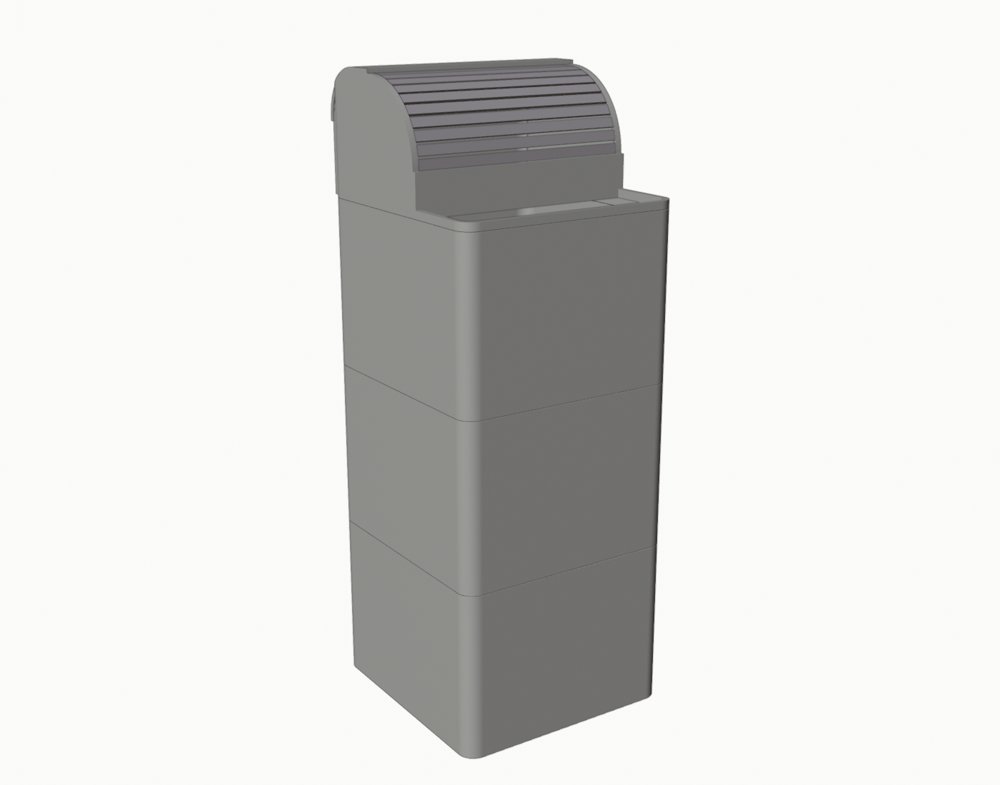
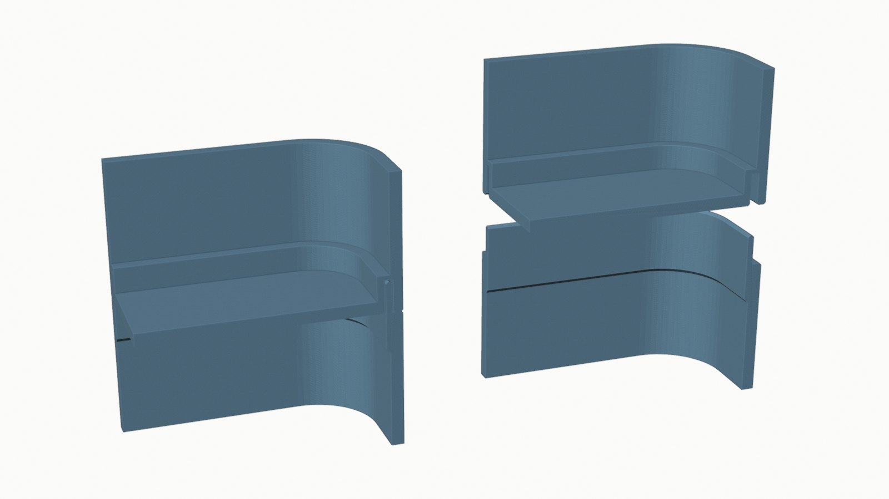
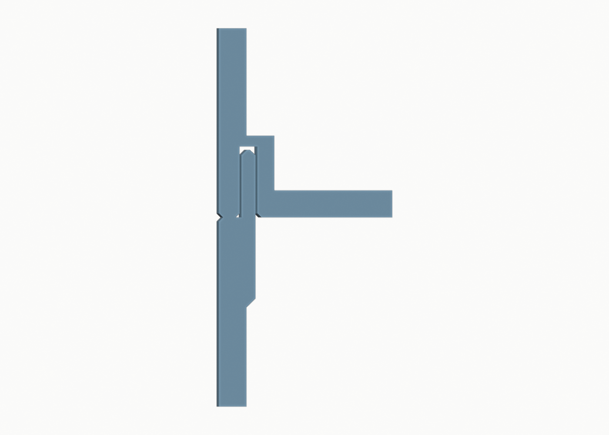
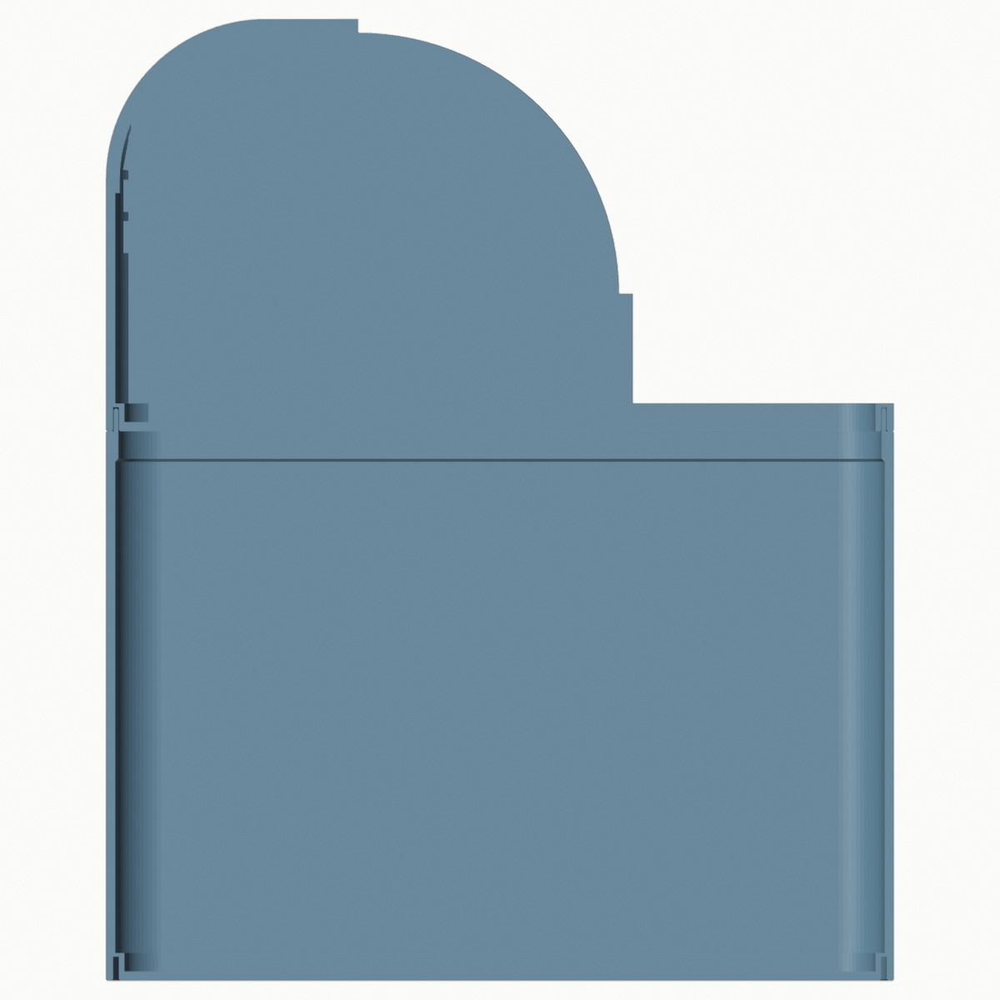
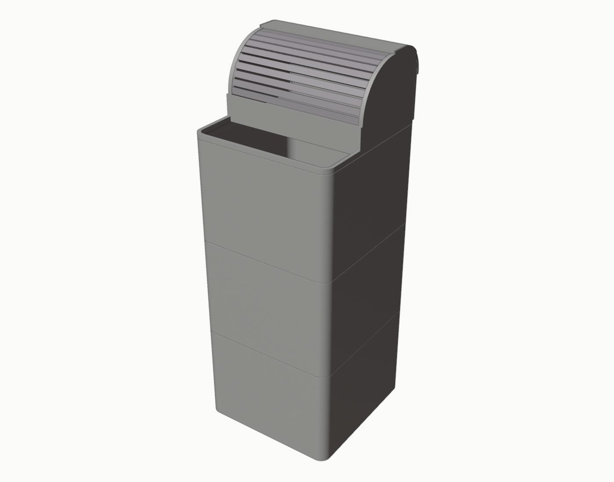
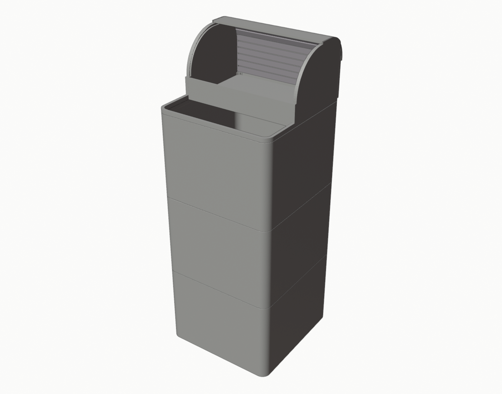
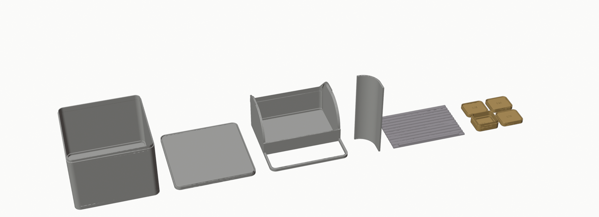
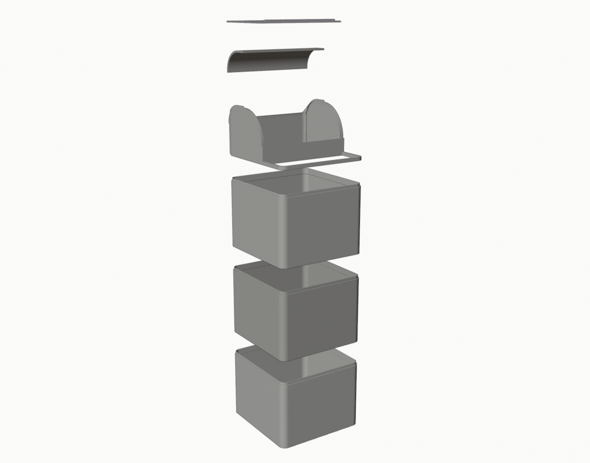

# LayerDock Stackable Bins

[layerdock](../../README.md) repo 裡的第二個產品。外觀極簡、圓角、可重複堆疊的隱藏式收納箱：**Bin × N + Lid × 1**，每個 Bin 都是一件印好就能用的完整容器（四面牆 + 一體成型的實心底板 + 頂部開口），堆起來像一根平整的圓角長方柱，用來取代桌上墊高衛生紙盒的空紙箱，順便把裡面的空間拿來收不常用的東西。

目前版本 **v0.1**：設計完成、STL 水密檢查通過、Bambu Studio 切片乾跑通過；接合試件已用 PLA 印出並測試（2026-10-21），正式件間隙定為 0.15，第一個 Bin 送印中。



Bin 只有一種 STL：[`stl/bin.stl`](stl/bin.stl)。頂層有兩種選擇：平的 [`stl/lid.stl`](stl/lid.stl)，或是給抽衛生紙用的捲簾容器 [`stl/top.stl`](stl/top.stl) + [`stl/door.stl`](stl/door.stl) + [`stl/roof.stl`](stl/roof.stl)（見下方「頂層」）。另有一個接合試件。

## 設計重點

| 項目 | 決定 | 原因 |
| --- | --- | --- |
| 外形 | 166 × 172 mm，四個垂直角 R12，Bin 高 120 mm（印出來含內唇 125 mm），Lid 厚 8.25 mm | 沿用 Open Frame 的 footprint，180 mm 平台四邊留 4–7 mm；120 mm 讓 2 層 = 248 mm、3 層 = 368 mm，都在 Jones 給的範圍內，一個 Bin 約 4 小時印完 |
| 牆 / 底 | 主牆 2.0 mm、底板 2.0 mm 實心、上緣 6 mm 區段加厚到 2.65 mm、底部腳座 4.0 mm | 2 mm 在 0.4 噴頭下是 4–5 條線，PLA 夠硬；只有需要容納機構的地方才加厚，省料也省時間 |
| 堆疊機構 | **隱藏內唇 + 底部凹槽**：每個 Bin 上緣內側長一圈 1.0 × 5 mm 的內唇，每個 Bin（和 Lid）底面外緣內側有一圈 1.3 × 5.25 mm 的凹槽；疊上去時下層的內唇插進上層的凹槽 | 從外面完全看不到；上下重量走「下層外緣平面 ↔ 上層外裙平面」面對面傳遞，內唇只負責定位，不承重；可以隨時把整個 Bin 拿起來 |
| 列印方向 | Bin 底板朝下、開口朝上直接印；Lid **上表面朝下**印（凹槽朝上） | 全部零件免支撐，唯一的懸空是 Bin 凹槽的 1.3 mm 天花板橋接；Lid 翻過來印則連橋接都沒有，而且上表面是紋理板的霧面 |
| 接縫 | 每個 Bin 的上緣和下緣外側各有 0.3 mm 導角，疊起來是一條 0.6 mm 寬的細 V 線 | 「細緻、平整的接縫」；同時抵消象腳效應，讓接縫不會外凸 |
| 材料 | PLA（切片報告以 Bambu PLA Basic 計算），PETG 亦可 | 室內靜置的收納箱，PLA 足夠 |

### 為什麼選「內唇 + 凹槽」而不是別的

| 方案 | 做法 | 結論 |
| --- | --- | --- |
| A. 底部塞頭（底板縮小一圈、突出到下層開口裡） | 上層底部有一圈比外牆內縮的塞頭，插進下層開口 | 塞頭和外牆之間一定有一段**朝下的水平肩面**（1.5–2 mm 懸空）或斜面；水平肩面印出來會下垂，正好是承重面；改成 45° 錐面則接縫會因公差留縫。不選 |
| B. 外露凸榫 / 卡扣 | 像 Open Frame 的方榫，或側面彈片 | 違反「外觀不能有卡扣或定位凸榫」；卡扣垂直列印時彈臂跨層線易斷 |
| C. 內唇 + 凹槽（**採用**） | 下層上緣內側一圈內唇朝上；上層底面一圈凹槽朝下接住它 | 只有垂直牆、平台上的平面和一道 1.5 mm 橋接，是 FDM 最好印的幾何；承重面是上層印在平台上的平面（最平整）對下層的頂面；機構藏在內側，外面只剩一條細縫 |





剖面裡由外往內：上層的**外裙**（1.5 mm，底面有 0.3 mm 接縫導角和 0.3 mm 槽口導角，實際承重環 0.9 mm 寬）→ **凹槽**（1.3 寬 × 5.25 深）→ **腳座**（1.2 mm）→ 底板。下層由外往內：**外緣平面**（1.75 mm 寬）→ **內唇**（1.0 厚 × 5 高，頂端 0.4 導角）→ 內牆。內唇和凹槽每邊間隙 0.15 mm（2026-10-21 試件：0.20 / 0.25 / 0.30 三個都放得進去，0.20 最緊、仍略鬆，Jones 決定正式件再緊一級用 0.15），上下間隙 0.25 mm，所以疊合後內唇頂端碰不到凹槽天花板，所有重量都壓在外緣的平面上。



### 老實說明

- **沒有正向鎖定**：和 Open Frame 一樣，Bin 之間只靠重力和內唇的側向限位；往上提就能拆開，這也是「可以隨時把整個 Bin 拿下來」的前提。側向推不會滑動（內唇要先剪斷，實際上整座塔會先傾倒）。
- **單獨一個 Bin 不蓋 Lid 時**，從上面看得到上緣內側 5 mm 高的內唇；蓋上 Lid 或疊上另一個 Bin 就看不到。這是這個方案唯一的外露特徵。
- 底板是實心的連續平面，但沒有做任何防水處理，不要拿來裝液體。

## 頂層：捲簾容器（top + door + roof，v0.3）

Jones 的用法（2026-10-22 照片）：最上層的 Bin 放抽取式衛生紙，再上面要一個「自己也是容器」的頂層放隨身包面紙等小物，並且有罩子遮灰。經過四個方案（[docs/concepts/](docs/concepts/)）、罩蓋版（v0.2）和一個 MakerWorld 捲簾化妝盒的參考後定案為**捲簾式**，三件：




| 零件 | 做法 | 為什麼 |
| --- | --- | --- |
| Top（捲簾容器） | **和 Bin 一樣一體成型、底板朝下直接印**：底部同款凹槽環套在最上層 Bin 的內唇上；**前 57 mm 整個挖空**（連底板都沒有，只留 6 mm 高的環）成 158 × 53 mm 的開口，手往下伸進 Bin 抽衛生紙；**後 115 mm** 是容器：2 mm 底板、30 mm 的矮前牆、兩側牆沿「R60 大弧 → 平頂 → R35 後上角」的輪廓升到 90 mm；側牆內側加一條 2.5 mm 的軌條，裡面刻 3 × 2 mm 的溝槽給門走（弧 → 平頂 → 後上角 → 沿後牆內側一路到底板，門從底板處的開口裝進去） | 容器、開口、弧形、軌道全在同一件上；內部 157 × 111 mm，前面 28 mm 深、後面 53 mm 深 |
| Door（捲簾門） | **平印一片、印完即用**：12 條 7 mm 寬、2.4 mm 厚的板條，板條之間 2 mm 寬、0.4 mm 厚（2 層）的活頁連成一片，寬 160.4 mm（兩端各伸進溝槽 1.7 mm）、長 106 mm；內面（活頁那面）朝下印，外面板條邊緣削 0.8 mm 的斜角，彎的時候縫張開成 V 形，就是化妝盒那種條紋；第一條板條上有一道 3 mm 高的把手 | 走 R60 的弧每個活頁彎 9°、走 R35 的後上角彎 20°，活頁應變約 1.5% / 3.5%，PLA 可以；板條太寬彎不過去會卡、太窄活頁太多太脆，7 mm 是折衷 |
| Roof（後半固定頂蓋） | 3 mm 厚，蓋住平頂（20 mm）和 R35 後上角，落在側牆和後牆頂緣的階梯裡（外 1 mm 唇全高、內側降 3 mm），門從它底下滑過 | 門只負責前面的大弧（約 94 mm），往後推就整個捲到頂蓋下面和後牆內側，容器全開。如果整個頂面都是門，門最多只能退後牆那 55 mm、開不到四成（化妝盒本身是靠 150 mm 高的後牆才能整片都是門） |

列印：Top 直立免支撐（溝槽是側牆上的水平細槽，槽頂 2 mm 深的小懸空切片器會標成 overhang，實際印得出來，可能有一點毛邊，第一次裝門前用刀把溝槽清一下）；Door 平印 27 層；Roof 側躺印（ㄈ 形剖面平放、163 mm 寬變成高度），`print/roof.3mf` 已開 8 mm brim。整座塔 3 層 + 頂層 = 450 mm。

可調參數：`top_lip_h`（矮前牆 30）、`cover_depth`（容器深度 115）、`roll_r1` / `roll_r2`（大弧 60、後上角 35）、`slat_w` / `slat_gap` / `slat_t` / `hinge_t`（板條 7 / 活頁 2 × 0.4 / 厚 2.4）、`slats`（12 條）、`track_w` / `track_depth` / `track_offset`（溝槽 3 × 2、中心線離外輪廓 5）。

老實說明（這一版沒有實測，捲簾的手感只能印了才知道）：
- 溝槽 3 mm 寬對 2.4 mm 的板條有 0.6 mm 餘隙、板條兩端各 0.3 mm；太鬆會晃、太緊會卡，第一次印完若卡，先清溝槽毛邊，再不行把 `track_w` 加 0.3。
- PLA 活頁 0.4 mm 厚，反覆開關會疲勞，是消耗件；門印 53 分鐘，壞了重印就好。PETG 印門會耐用很多。
- 門從底板的開口裝入：把門捲成弧、兩端對準後牆底部的溝槽往上推，再沿軌道推到前面。
- 開口 158 × 53 mm，手要伸進 120 mm 深的 Bin 抓衛生紙，衛生紙包放靠前面比較好抽。

## 各零件

已切好的 Bambu Studio 專案檔在 [`print/`](print/)（A1 mini、Bambu PLA Basic、0.20 mm Standard、紋理 PEI、**3 層牆、象腳補償 0.15 mm**，其餘預設），直接開啟按 Print。要印第 N 個 Bin 就再開一次 `print/bin.3mf`。



| 零件 | 檔案 | 數量 | 說明 |
| --- | --- | --- | --- |
| Bin | `stl/bin.stl` | 2–3 | 166 × 172 × 125 mm（含內唇），內部淨空 162 × 168 × 118 mm，約 **3.2 L** |
| Lid | `stl/lid.stl` | 0–1 | 166 × 172 × 8.25 mm 的實心板，底面有一圈和 Bin 一樣的凹槽；檔案已經是翻面的列印方向。要平頂時用 |
| Top | `stl/top.stl` | 0–1 | 166 × 172 × 90 mm，一體成型的捲簾容器（後 2/3 容器 + 溝槽側牆、前 1/3 直通），直立印 |
| Door | `stl/door.stl` | 0–1 | 160.4 × 106 × 5.4 mm 捲簾門，12 條板條 + 活頁，平印 |
| Roof | `stl/roof.stl` | 0–1 | 163.4 mm 寬的後半固定頂蓋，檔案已經是側躺的列印方向，**開 brim** |
| 接合試件 | `stl/test-coupon.stl` | 1 | 一個 50 × 42 × 14 mm 的迷你 Bin（有內唇）+ 三個迷你 Lid，凹槽間隙分別 0.20 / 0.25 / 0.30 mm；每個迷你 Lid 的凹槽面刻有 **0.20 / 0.25 / 0.30** 字樣（印出來朝上的那一面），前側另刻 1 / 2 / 3 道直槽對應，迷你 Bin 底板刻 BIN。**先印這個** |



## A1 mini 列印驗證

### 已做：Bambu Studio 2.x CLI 切片乾跑（本機實際切片，未列印）

`Bambu Lab A1 mini 0.4 nozzle` + `0.20mm Standard @BBL A1M` + `Bambu PLA Basic` + 紋理 PEI 板，只改了 `wall_loops=3`、`elefant_foot_compensation=0.15`。完整表在 [docs/print-report.md](docs/print-report.md)。

| 零件 | 時間 | 材料 | 噴頭實際走過的範圍 | 自動 brim | 支撐 | 懸空 / 橋接 |
| --- | --- | --- | --- | --- | --- | --- |
| Bin | 4 h 04 m | 255 g | 165.6 × 171.6 mm | 判定不需要 | 無 | 只有凹槽天花板一道 1.3 mm 橋接 |
| Lid | 1 h 48 m | 105 g | 165.6 × 171.6 mm | 判定不需要 | 無 | 無（橋接標記全是上層實心面蓋在填充上） |
| Top | 3 h 10 m | 142 g | 165.6 × 171.6 mm | 判定不需要 | 無 | 凹槽天花板 + 溝槽槽頂的 2 mm 小懸空 |
| Door | 53 m | 34 g | 160.0 × 105.4 mm | 判定不需要 | 無 | 無 |
| Roof | 1 h 30 m | 45 g（含 brim） | 52.4 × 69.0 mm（含 8 mm brim） | **手動開 8 mm** | 無 | 無（側躺印，0 懸空） |
| 試件 | 57 m | 40 g | 107.6 × 91.6 mm | 判定不需要 | 無 | 同 Bin |

2 層 + Lid 約 **10 小時、615 g**；3 層 + Lid 約 **14 小時、870 g**；3 層 + Top + Door + Roof 約 **18 小時、990 g**。切片結果沒有任何 overhang wall、沒有支撐。

### 幾何層面的檢查（`../../tools/check_stl.py`，每次建置都跑）

- 三個 STL 都是水密、流形、法線向外、原點在平台上、外形 ≤ 180 mm。Bin 和 Lid 是用「牆面剖面繞圓角矩形掃掠」直接建出的單一封閉網格，沒有布林運算，所以先天就是水密的。
- 平台接觸面：Bin 是整片底板 + 腳座環 + 外裙環，幾乎是整個 166 × 172 的底面；Lid 是整片上表面。大平面 PLA 在紋理 PEI 上不太翹，但這是 166 × 172 的實心平板，第一片印出來要看四角。
- 象腳效應：凹槽槽口有 0.3 mm 導角，加上切片 0.15 mm 象腳補償；內唇頂端 0.4 mm 導角做導入。

### 建議的列印設定

- 已經寫進 `print/` 的 3MF：牆 3 層、象腳補償 0.15 mm。
- 填充 15% 預設即可（Bin 的牆是實心的，填充只用在底板中間和 Lid 板子裡）。
- Brim：自動判定不需要。若第一片 Bin 的四角翹起，開 3 mm brim 仍在 180 mm 內（166 + 6 = 172、172 + 6 = 178）。
- 第一層用預設，紋理 PEI 不需要膠水。印 Lid 時上表面就是第一層，平台要乾淨。

### 尚未做（需要實體測試）

1. ~~內唇 / 凹槽的間隙~~ 已測（2026-10-21，PLA 試件）：0.20 / 0.25 / 0.30 都放得進去且不卡，0.20 最緊但仍略鬆。迷你件很輕、周長只有正式件的四分之一，所以手感偏鬆；Jones 決定正式件直接用 **0.15**（比試過的最緊值再緊 0.05，試件沒測過這一級）。若正式件太緊壓不到底，退回 0.20。
2. ~~凹槽槽口的象腳~~ 試件沒有卡住，象腳補償 0.15 + 0.3 mm 槽口導角足夠。
3. 166 × 172 實心底板的翹曲；Bin 印到 125 mm 高時牆面的品質（A1 mini 是平台前後移動的機型，不過這個零件底面整片貼平台，不會晃）。
4. 接縫的外觀：0.6 mm 的 V 線在實物上是否夠「細緻」；不夠細可以把 `seam_chamfer` 降到 0.2。
5. Lid 的 15% 填充板子放上衛生紙盒會不會凹（計算上不會，見下）。

## 穩定性評估（計算值，未實測）

質量用切片器估計：Bin 255 g、Lid 105 g。底座半寬 83 × 86 mm。衛生紙盒以 300 g、230 × 115 × 80 mm 估。

| 狀態 | 總重 | 重心高度 | 傾倒角 | 在最高處水平推多少力會倒 |
| --- | --- | --- | --- | --- |
| 2 層空 Bin + Lid | 0.62 kg | 133 mm | 32° | 約 2.0 N |
| 3 層空 Bin + Lid | 0.87 kg | 193 mm | 23° | 約 1.9 N |
| 3 層 + Lid + 衛生紙盒 | 1.17 kg | 249 mm | 18° | 約 2.1 N（推在衛生紙盒頂） |
| 3 層 + 衛生紙盒，最下層放 1 kg 東西 | 2.17 kg | 152 mm | 29° | 約 3.9 N |

結論：這是桌上的輕物件，3 層塔被 2 N 左右（約 200 g 力）的側推就會倒，和任何同高度的紙箱一樣；重的東西放最下層、塔放在桌子後緣靠牆最穩。不需要固定，但 3 層放在桌子邊緣被手肘撞到會整座倒。2 層明顯比 3 層穩。

其他項目：

- **層間承重**：重量經 0.9 mm 寬的承重環傳遞，周長約 676 mm，接觸面約 600 mm²；放 10 kg 也不到 0.2 MPa，對 PLA（抗壓 50 MPa 以上）可忽略。Bin 的 2 mm 牆以垂直方向承重，120 mm 高不會挫曲。
- **側向滑動**：內唇 5 mm 高、1 mm 厚、繞整圈；要讓上層水平滑開必須剪斷整圈內唇，實際上塔會先倒。每個接面的水平餘隙 2 × 0.15 = 0.3 mm，3 層全同方向累積也只有 0.9 mm。
- **Lid 承重**：8.25 mm 的夾層板（上下實心面 + 15% 填充），放 1 kg 跨 160 mm 的計算撓度遠小於 0.1 mm。
- **底板**：2 mm 實心 PLA，裝 2 kg 雜物時中央下垂約 0.5 mm，拿起來不會覺得軟。
- **桌面防滑**：底面是紋理 PEI 印出來的 PLA 平面，在木桌上摩擦係數普通；這版沒做防滑腳。要的話貼四片矽膠腳墊最簡單（厚度加在 Bin 底面不影響堆疊）。
- **長期變形**：靜載下的應力極小，PLA 在室溫不會蠕變；但 PLA 在 50–55 °C 以上會軟，不要放在西曬窗邊或車裡。

## 組裝

1. 第一個 Bin 放桌上，開口朝上。
2. 第二個 Bin 對準放上去：底面的凹槽套住下層的內唇，內唇頂端有導角，大致對準就會自己滑進去，壓到外緣貼合。
3. 要幾層就疊幾個。
4. 頂層二選一：Lid 凹槽朝下蓋上；或 Top 凹槽朝下、開口朝前套上，Roof 放進側牆和後牆頂緣的階梯裡，Door 捲成弧從後牆底部的溝槽開口裝入、沿軌道推到前面。
5. 抽取式衛生紙放最上層 Bin，從 Top 前面的開口往下抽；隨身小物放 Top 的容器裡，把捲簾往後推就能拿。

要拿東西：把 Lid（或上面整疊 Bin）往上提起來即可。

## 改參數、重新輸出

所有尺寸都在 [`scad/stackable-bins.scad`](scad/stackable-bins.scad) 最上面的參數區：`bin_h`（層高）、`bin_w` / `bin_d`、`corner_r`、`wall`、`floor_t`、`fit`（內唇間隙）、`lip_h`、`seam_chamfer` 等。幾何在兩個地方各寫一份：`.scad`（OpenSCAD）和 `tools/build_stl.py`（Blender，讀同一份參數區），模組一一對應。

```bash
tools/build.sh            # Blender 建 STL + 預覽圖 + STL 檢查
tools/build.sh --slice    # 再加 Bambu Studio 切片乾跑，更新 docs/print-report.md 並把 3MF 複製到 print/
```

- **這台 Mac 沒裝 OpenSCAD**，`.scad` 到目前為止沒有被執行過；STL 全部來自 Blender 版（用掃掠直接建網格，不經布林運算）。裝了 OpenSCAD 之後可以用 `openscad -D 'part="bin"' -o /tmp/bin.scad.stl scad/stackable-bins.scad` 輸出，再用 `../../tools/check_stl.py /tmp/bin.scad.stl` 比對體積（Blender 版：Bin 216.7 cm³、Lid 229.1 cm³）。
- 想要 150 mm 的 Bin：把 `bin_h` 改 150（印出來 155 mm，仍在 180 內），重跑 `tools/build.sh --slice`。

## 參考

- [Interlocking Modular Drawers v2](https://makerworld.com/zh/models/1516456-interlocking-modular-drawers-v2)（MakerWorld）：外形參考。本專案的幾何全部自己設計，沒有使用該模型的檔案或機構。
